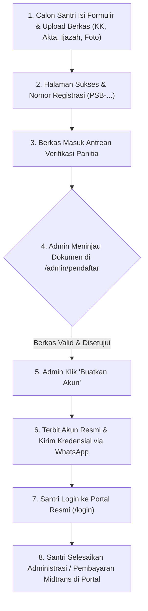

# 🏫 Sistem Informasi Akademik & Penerimaan Santri Baru (PSB) - Pondok Pesantren Al-Fattah

Sistem Informasi Terpadu berbasis web untuk **Pondok Pesantren Al-Fattah Tigaraksa, Kabupaten Tangerang**. Aplikasi ini dikembangkan menggunakan **Laravel 12**, **Tailwind CSS**, dan database **SQLite / MySQL** dengan arsitektur **Multi-Role Access Control (RBAC 5 Level)**, integrasi payment gateway **Midtrans**, serta modul pelaporan eksekutif.

---

## 🌟 Fitur Utama & Multi-Role Access Control (5 Roles)

Sistem ini memiliki 5 hak akses pengguna dengan portal, hak otorisasi, dan antarmuka (UI/UX) yang disesuaikan:

### 1. 👑 Portal Administrator (`/admin/dashboard`)
* **Manajemen Pengguna (User Management)**: CRUD user lengkap (Tambah Akun Baru, Ubah Role, Filter Role, Pencarian Cepat, dan Reset Password).
* **Verifikasi & Validasi Berkas Pendaftar**: Meninjau formulir pendaftaran, pratinjau berkas (KK, Akta Kelahiran, Ijazah/SKL, Pasfoto), dan tombol **"Terbitkan Akun Santri"** dengan fitur kirim kredensial otomatis via WhatsApp.
* **Manajemen Akademik Terpadu**:
  * Data Santri & Siswa Aktif
  * Data Guru & Pengajar
  * Data Rombongan Belajar (Kelas)
  * Data Mata Pelajaran (Mapel)
* **Kelola Content Management System (CMS)**:
  * Hero Banner Carousel Landing Page
  * Berita & Pengumuman Pesantren
  * Video Kegiatan YouTube
  * Testimoni Alumni
* **Rekap Transaksi Midtrans**: Monitoring log pembayaran infaq/pendaftaran secara real-time.

### 2. 🏛️ Portal Ketua Yayasan (`/yayasan/dashboard`)
* **Dashboard Eksekutif Yayasan**: Ringkasan statistik operasional pondok pesantren secara menyeluruh.
* **Laporan Terpadu & Cetak PDF**:
  * Laporan Santri Aktif
  * Laporan Data Guru & Staf
  * Laporan Rekap Nilai Akademik
  * Laporan Presensi / Absensi Santri
  * Laporan Rekap Keuangan & Infaq Pendaftaran
  * Laporan Pendaftar Santri Baru

### 3. 🎓 Portal Kepala Sekolah (`/kepsek/dashboard`)
* **Monitoring Akademik**: Pantauan harian terhadap kegiatan belajar mengajar santri.
* **Laporan Manajerial Sekolah**:
  * Laporan Perkembangan Santri
  * Laporan Kinerja & Distribusi Mengajar Guru
  * Laporan Hasil Penilaian Santri
  * Laporan Rekapitulasi Presensi Santri
  * Laporan PSB (Penerimaan Santri Baru)

### 4. 👨‍🏫 Portal Guru & Pengajar (`/guru/dashboard`)
* **Input Penilaian Santri (`/guru/nilai`)**: Pengisian nilai harian, PTS, dan PAS santri berdasarkan kelas dan mata pelajaran yang diampu.
* **Presensi / Absensi Harian Santri (`/guru/absensi`)**: Pencatatan kehadiran santri (Hadir, Sakit, Izin, Alpa).
* **Rekapitulasi Nilai (`/guru/rekap`)**: Cetak dan pratinjau rekap daftar nilai santri.

### 5. 🧑‍🎓 Portal Santri / Wali Santri (`/dashboard`)
* **Biodata Resmi Santri**: Profil lengkap, NISN, NIK, dan asal rombel/kelas.
* **Cek Nilai & Transkrip Akademik**: Pemantauan hasil belajar dan evaluasi berkala.
* **Jadwal Pelajaran**: Jadwal harian tatap muka mata pelajaran santri.
* **Status Pembayaran & Midtrans**: Status registrasi, riwayat transaksi, dan cetak kwitansi pembayaran resmi.

---

## 📋 Alur Pendaftaran Santri Baru (PSB Online)

Alur penerimaan santri baru dirancang higienis, aman, dan terverifikasi berkas terlebih dahulu:



---

## 🔑 Akun Resmi Default (Database Seeder)

Untuk keperluan pengujian, sistem menyediakan 1 akun resmi untuk masing-masing role:

| Role | Nama Pengguna | Alamat Email | Kata Sandi | Portal Dashboard |
|---|---|---|---|---|
| 👑 **Administrator** | Admin Al-Fattah | `admin@gmail.com` | `password` | `/admin/dashboard` |
| 🏛️ **Ketua Yayasan** | Ketua Yayasan Al-Fattah | `yayasan@gmail.com` | `password` | `/yayasan/dashboard` |
| 🎓 **Kepala Sekolah** | KH. Iskandar Zulkarnaen, M.M.Pd. | `kepsek@gmail.com` | `password` | `/kepsek/dashboard` |
| 👨‍🏫 **Guru / Pengajar** | Ust Mohamad Paisal | `guru@gmail.com` | `password` | `/guru/dashboard` |
| 🧑‍🎓 **Santri / Wali** | Ahmad Santri | `santri@gmail.com` | `password` | `/dashboard` |

> **Catatan:** Halaman login (`/login`) bersih tanpa tombol demo. Admin dapat menambahkan akun pengguna baru kapan saja melalui menu **Manajemen Pengguna** di dashboard admin.

---

## 🛠️ Tech Stack & Dependencies

* **Backend Framework**: Laravel 12.x (PHP 8.2+)
* **Frontend UI**: Blade Templating, Tailwind CSS, Alpine.js, Bootstrap 5, Iconify, Lucide Icons
* **Database**: SQLite (Default Quick Setup) / MySQL / MariaDB
* **Payment Gateway**: Midtrans Snap API (QRIS, VA Bank, E-Wallet)
* **PDF Generator**: `barryvdh/laravel-dompdf`
* **Excel Export**: `maatwebsite/excel`
* **Development Server**: Laragon / XAMPP & Vite

---

## 🚀 Langkah Instalasi & Menjalankan Project

### 1. Pindah ke Folder Project & Install Dependencies
```bash
cd "D:\Kuliah\Semester 8\ProjectWork\my-fattah-main"
composer install
npm install
```

### 2. Konfigurasi Environment & Key
```bash
copy .env.example .env
php artisan key:generate
```

### 3. Migration & Seeder Database
Jalankan migrasi tabel beserta data resmi default:
```bash
php artisan migrate:fresh --seed
```

### 4. Storage Link Asset
Hubungkan folder penyimpanan publik agar berkas/foto dokumen pendaftar dapat diakses:
```bash
php artisan storage:link
```

### 5. Menjalankan Server Development
Buka **2 Terminal**:

**Terminal 1 (Laravel Server):**
```bash
php artisan serve
```

**Terminal 2 (Vite Compiler):**
```bash
npm run dev
```

Akses aplikasi di browser: **`http://127.0.0.1:8000`**

---

## 📄 Lisensi & Peruntukan
Project ini dikembangkan untuk kepentingan akademik **Skripsi / Tugas Akhir Sarjana Komputer (S.Kom)** di Pondok Pesantren Al-Fattah Tigaraksa, Kabupaten Tangerang.
